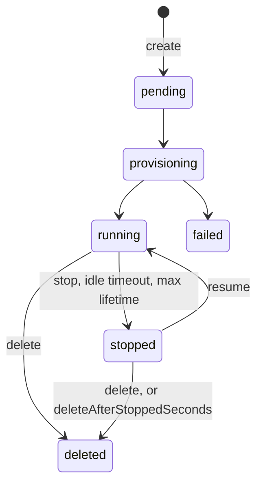

import { Tabs } from "nextra/components";

# How sandboxes work

A sandbox is an isolated Linux workspace with its own filesystem, processes, network policy, size and lifetime.
This page explains the states a sandbox moves through, what it keeps when it stops, and the terms the rest of these docs use.

## Containers and microVMs

Every sandbox runs on one of two runtimes. Choose with `runtime` on create, or leave it out for the platform default.

| `runtime` | Isolation |
|---|---|
| `docker` | A container on the host's kernel. |
| `firecracker` | A microVM with its own kernel. It runs only images pinned by `repository@sha256` that list `firecracker` among their runtimes. |

Run `tangle environments list` to see each image's runtimes.

No create option picks a region.
`compliance: { hipaa: true }` narrows placement to capacity that can take HIPAA workloads; see [Isolation and compliance](/sandbox/security).

## Sandbox sizes

A sandbox gets a CPU, memory and disk size from a named preset or from numbers you pass in `resources`.
Read the presets, the default and the largest size your account can get:

<Tabs items={["TypeScript", "Python", "CLI"]} storageKey="sandbox-lang">
<Tabs.Tab>

```ts
const { presets, default: defaultPreset, ceiling } = await client.shapes();
console.log(defaultPreset, ceiling);
```

</Tabs.Tab>
<Tabs.Tab>

The Python SDK has no shapes method. Call the route through `client.fetch`:

```python
shapes = client.fetch("GET", "/v1/shapes").json()
print(shapes["default"], shapes["ceiling"])
```

</Tabs.Tab>
<Tabs.Tab>

```bash
tangle sandbox shapes
```

</Tabs.Tab>
</Tabs>

A create that names no size gets the default preset, clamped to your ceiling.
A create that names numbers above your ceiling is refused with `RESOURCES_EXCEED_LIMIT`.
A create that sends no `resources` gets a smaller disk than the default preset names, so set `resources.diskGB` when you need more. See [Limits and timeouts](/sandbox/limits).

## Sandbox states

`box.status` is one of these values.

| Status | Meaning |
|---|---|
| `pending` | The create was accepted. |
| `provisioning` | The sandbox is starting. |
| `running` | Commands, files and coding agents work. |
| `stopped` | Compute is off and the disk is kept. Resume to run again. |
| `failed` | The sandbox could not start or broke. `box.error` holds the reason. |
| `expired` | The sandbox can no longer run. Treat it like `deleted`. |
| `deleted` | The sandbox is gone. |



In TypeScript, `client.create()` returns once the sandbox is `running`.
In Python, `create()` returns earlier, so call `wait_for(SandboxStatus.RUNNING)` before running anything.

## Timers stop a sandbox; only delete removes it

| Option | What happens |
|---|---|
| `idleTimeoutSeconds` | The sandbox stops after this long with no activity. |
| `maxLifetimeSeconds` | The sandbox stops this long after create or resume. Activity does not extend it. Each resume starts a new interval. |
| `deleteAfterStoppedSeconds` | A stopped sandbox is deleted after this long. Resume restarts the clock. The default is 30 days. |

Leave a timer out and the platform's policy applies.
The CLI sets its own defaults: `--lifetime 3600` and `--idle-timeout 900`, in seconds.

A stopped sandbox does not bill compute. A sandbox you forget to delete stays on your account until `deleteAfterStoppedSeconds` runs out, so delete sandboxes in a `finally` block.
See [Create, stop and delete](/sandbox/lifecycle) and [Pricing and spend](/sandbox/cost).

## What survives a stop

| Kept | Lost |
|---|---|
| Files in the workspace | Running processes, including dev servers. Start them again after resume. |
| Coding-agent conversations, by session id | Model credentials the agent was started with. Send `backend` again with the first prompt after resume. |
| Snapshots | |

A long stop can release the sandbox's compute. Resume then starts it again from its saved workspace under the same id, which takes longer.

## The coding agent inside a sandbox

By default (`agent: true`) a sandbox has a coding agent installed: OpenCode, or Claude Code, Codex or another one you pick with `backend.type`.
You talk to it with `box.prompt()` and sessions.

`agent: false` gives plain compute. Files, commands and lifecycle work, but the sandbox gets no model credentials, no coding agent and no startup scripts; a create that names a startup script with `agent: false` is refused with a 400.

List the coding agents your account can use with `client.listBackends()` or `GET /v1/backends`; see [Run a coding agent](/sandbox/cloud-agents).

## Network access

With no policy, a sandbox can reach package registries, git hosts, container registries, CDNs and Tangle's own services, and nothing else.
An explicit `strict` policy reaches only the domains you list, unless you also set `includeImplicitDomains: true`.
See [Network access](/sandbox/egress).

## Personal and team sandboxes

A sandbox belongs to you or to a team. Pass `teamId` on create (`--team` in the CLI) to create it in a team, where the team's members can see it.
`client.list({ scope })` takes `personal`, `team`, `team:<id>` or `all`. See [Teams](/sandbox/teams).

## The security boundary

A sandbox is one trust domain. Coding agents and processes in the same sandbox can read each other's files.
Use separate sandboxes for separate customers or for code that must not see each other's data. See [Isolation and compliance](/sandbox/security).

## Terms used in these docs

| Term | Meaning | Read more |
|---|---|---|
| Sandbox | An isolated Linux workspace with a lifetime and a network policy. | [Create, stop and delete](/sandbox/lifecycle) |
| Coding agent | The agent installed in a sandbox, such as Claude Code, Codex or OpenCode. | [Run a coding agent](/sandbox/cloud-agents) |
| Session | One conversation with a coding agent. Reuse its id to continue it. | [Sessions](/sandbox/sessions) |
| Turn | One prompt and the agent's work on it. | [Sessions](/sandbox/sessions) |
| AgentProfile | The model, instructions, tools, MCP servers and permissions a coding agent runs with. | [AgentProfiles](/sandbox/cloud-agents-profiles) |
| Template | A saved starting point that new sandboxes are created from. | [Templates and images](/sandbox/templates-gallery) |
| Environment | A named image a sandbox starts from. | [Templates and images](/sandbox/templates-gallery) |
| Snapshot | A saved copy of a sandbox's files that you can restore or create from. | [Snapshots and forks](/sandbox/snapshots) |
| Branch | A copy of a running sandbox, made in one call. | [Snapshots and forks](/sandbox/snapshots) |
| Preview link | A public URL that reaches a port inside the sandbox. | [Ports and preview links](/sandbox/ports-previews) |
| Fleet | Several sandboxes under one budget and lifecycle. | [Fleets](/sandbox/agents-fleet) |
| Instance | One named sandbox per key, such as one per end user. | [One sandbox per user](/sandbox/instances) |
| Line | An email, iMessage or voice number that reaches a coding agent. | [Email, iMessage and voice lines](/sandbox/lines) |
| Scoped token | A short-lived token that lets a browser reach one sandbox. | [API keys and tokens](/sandbox/authentication) |

## Next steps

- [Create, stop and delete](/sandbox/lifecycle): every create option and lifecycle call.
- [Run commands and code](/sandbox/commands): `exec`, processes and code kernels.
- [Run a coding agent](/sandbox/cloud-agents): pick the agent, model and credential.
