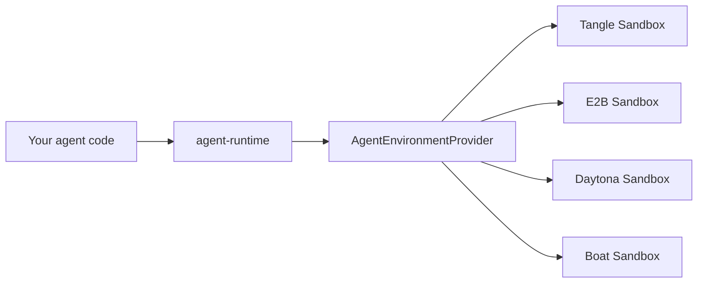

# Run the same agent on E2B, Daytona, or Boat

The `AgentEnvironmentProvider` contract means your agent code runs unchanged on any supported cloud. Swap the provider adapter, keep the same `AgentProfile`, the same runtime calls, and the same accounting.

## How it works



Every provider implements the same `AgentEnvironmentProvider` interface. Your profile, your turns, your budgets, and your evaluation — all identical. Only the sandbox underneath changes.

## Install

```bash
# Tangle (default)
pnpm add @tangle-network/agent-provider-tangle

# E2B
pnpm add @tangle-network/agent-provider-e2b

# Daytona
pnpm add @tangle-network/agent-provider-daytona

# Boat
pnpm add @tangle-network/agent-provider-boat
```

## Quickstart: swap providers in one line

```ts
import { providerAsSandboxClient, runAgentRounds } from "@tangle-network/agent-runtime/kernel";
import type { AgentProfile } from "@tangle-network/agent-interface";

// Your agent definition — identical across all providers
const profile = {
  name: "my-agent",
  harness: "claude-code",
  model: { provider: "anthropic", default: "anthropic/claude-sonnet-4-6" },
} satisfies AgentProfile;

// === Option A: Run on Tangle ===
import { Sandbox } from "@tangle-network/sandbox";
import { createTangleProvider } from "@tangle-network/agent-provider-tangle";

const tangleProvider = createTangleProvider({
  client: new Sandbox({
    apiKey: process.env.TANGLE_API_KEY!,
    baseUrl: "https://sandbox.tangle.tools",
  }),
});

// === Option B: Run on E2B ===
import { createE2BProvider } from "@tangle-network/agent-provider-e2b";

const e2bProvider = createE2BProvider({
  apiKey: process.env.E2B_API_KEY,       // defaults to E2B_API_KEY
  router: { key: process.env.TANGLE_API_KEY! },  // model calls still route through Tangle
});

// === Option C: Run on Daytona ===
import { createDaytonaProvider } from "@tangle-network/agent-provider-daytona";

const daytonaProvider = createDaytonaProvider({
  // apiKey, apiUrl, target default to DAYTONA_API_KEY, DAYTONA_API_URL, DAYTONA_TARGET
  router: { key: process.env.TANGLE_API_KEY! },
});

// The same run works on any of them:
const client = providerAsSandboxClient(e2bProvider);  // ← swap here

const result = await runAgentRounds({
  task: "Fix the failing test in src/utils/date.ts",
  driver: {
    plan: async (task, history) => (history.length === 0 ? [task] : []),
    decide: () => "done" as const,
  },
  agentRun: { profile, taskToPrompt: (t) => t },
  output: { parse: (events) => events },
  ctx: { sandboxClient: client },
});
```

## What each provider supports

| Capability | Tangle | E2B | Daytona | Boat |
|---|---|---|---|---|
| Agent harnesses (Claude Code, Codex, etc.) | ✅ All 8 | ✅ Via CLI Bridge | ✅ Via CLI Bridge | ✅ Via CLI Bridge |
| Model inference through Tangle Router | ✅ Native | ✅ `router.key` | ✅ `router.key` | ✅ `router.key` |
| Git repo checkout | ✅ | ✅ | ✅ | ✅ |
| Checkpoints & snapshots | ✅ | ❌ | ✅ | ✅ |
| Fork from checkpoint | ✅ | ❌ | ✅ | ✅ |
| Egress allowlists | ✅ `strict`/`blocked`/`open` | ❌ | ✅ `domainAllowList` | ❌ |
| Custom images | ✅ | ❌ Template-based | ❌ Snapshot-based | ❌ Setup script |
| Resource limits | ✅ | ❌ Fixed by template | ❌ | ❌ |
| Secrets | ✅ | ❌ | ❌ | ❌ |
| Idempotent create | ✅ | ❌ | ❌ | ❌ |
| Durable resume | ✅ | ❌ | ❌ | ❌ |
| Sandbox lifetime | ✅ Manual | ✅ `lifetimeMs` | ✅ `ttlMinutes` | ✅ `ttlSeconds` |
| Run tagging | ✅ | ✅ Metadata | ✅ Labels | ✅ Labels |

**Fields marked ❌ are refused with an `EnvironmentProviderError` that names the field** — before any provider call, so you get a clear error rather than a silent no-op.

## When to use each provider

| Use Tangle when | Use E2B when | Use Daytona when | Use Boat when |
|---|---|---|---|
| You need durable resume, secrets, or custom images | You want the simplest setup and don't need snapshots | You need checkpoints/forks on a budget | You want snapshot-based workflows on Boat's infra |
| Your agents run long-lived sessions | Your tasks are short and stateless | You need to fork from a known-good state | You're already on Boat and want agent support |
| You need egress control for compliance | Your agent doesn't need network restrictions | You want per-domain egress rules | You want the lightest vendor surface |

## Building the box image for E2B and Daytona

E2B and Daytona sandboxes run CLI Bridge from a pre-built box. Build it once per CLI Bridge pin:

```bash
# From the agent-sdk repository root

# E2B: publishes a template
pnpm build:sandbox-image --target e2b

# Daytona: prints DAYTONA_SNAPSHOT=<name>
DAYTONA_API_KEY=... pnpm build:sandbox-image --target daytona
```

The pinned Bridge and harness installs are included in the image. Pass `template` (E2B) or `snapshot` (Daytona) to use a specific build, or `workspace.environment` on individual creates.

## The provider contract

Every provider implements `AgentEnvironmentProvider`:

```ts
interface AgentEnvironmentProvider {
  /** Human-readable name for diagnostics. */
  readonly name: string;

  /** Create an environment. Refuses unsupported fields before any call. */
  create(input: CreateAgentEnvironmentInput): Promise<EnvironmentHandle>;

  /** List environments matching a filter. */
  list(filter?: ListFilter): AsyncIterable<SandboxInfo>;

  /** Advertise what this provider actually supports. */
  capabilities(): ProviderCapabilities;
}
```

Unsupported fields are refused with `EnvironmentProviderError` naming the field — never silently dropped.

## Conformance testing

Every provider passes the same conformance suite before publishing:

```bash
# From any provider package
pnpm test:live
```

The suite runs `runLiveProfileConformance` from `@tangle-network/agent-provider-testkit`: 67 checks covering create, turns, teardown, accounting, error paths, and capability truthfulness. Without credentials, it reports `no credential: <NAME>` and proves nothing.

## Next steps

- [Run agents with agent-runtime](/sandbox/agent-runtime)
- [Evaluate agents with agent-eval](/sandbox/evaluation)
- [agent-sdk on GitHub](https://github.com/tangle-network/agent-sdk)
- [Provider testkit](https://github.com/tangle-network/agent-sdk/tree/main/packages/agent-provider-testkit)
